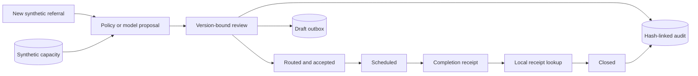

# CareLoop architecture

## Execution contract

Routing chooses only providers with matching service and region and positive
synthetic capacity. The deterministic policy sorts by available capacity, then
provider ID. Model proposals use the same allowlist; they cannot create providers.

A proposal hashes referral ID, version, provider, action, and origin. Approval
validates that content. A transaction rechecks version, eligibility, and capacity,
then commits the referral update, audit event, optional draft, and idempotency
result together. Replay returns the original result; a changed command with the
same key fails. Scheduling requires a future slot. Completion cannot precede it.
Closure performs a separate local lookup of the referral-bound completion receipt.

Every audit entry includes the previous hash. Partial alteration and missing
entries are detectable. The database owner can rewrite the whole chain; it is
not signed or anchored in an external audit system.

## Code map

| Location | Responsibility |
| --- | --- |
| `careloop/service.py` | Domain behavior, invariants, and transitions |
| `careloop/cli.py` | Module and installed commands; synthetic demo |
| `careloop/provider.py` | Opt-in bounded JSON model transport |
| `careloop/report.py` | Self-contained run explorer |
| `tests/` | Domain, CLI, and transport regressions |
| `examples/` | Synthetic inputs and captured outputs |

## Authority and trust

The local caller controls files, reviewer labels, and endpoint configuration.
Model output has no special privileges. A hash binds content, not human identity.
The database and Python process are trusted. A hosted deployment would require
identity, access control, secret management, resource limits, monitoring, and
operational review.

## Boundaries

This is an administrative simulation, not medical software. It performs no
diagnosis, triage, treatment selection, EHR integration, messaging, or real patient
matching. It has no authentication, tenant isolation, calendar integration, or
automatic capacity replenishment. Capacity is a fixed fictional booking allocation.
Receipt lookup verifies a local synthetic record, not an external provider's work.
Reviewer and owner fields are local labels.
